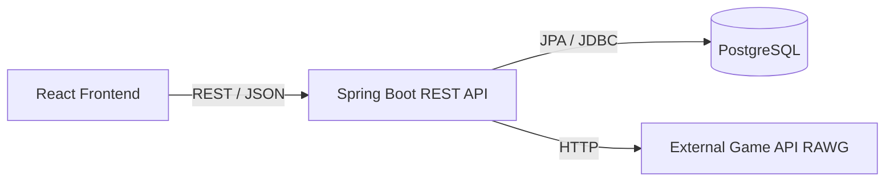
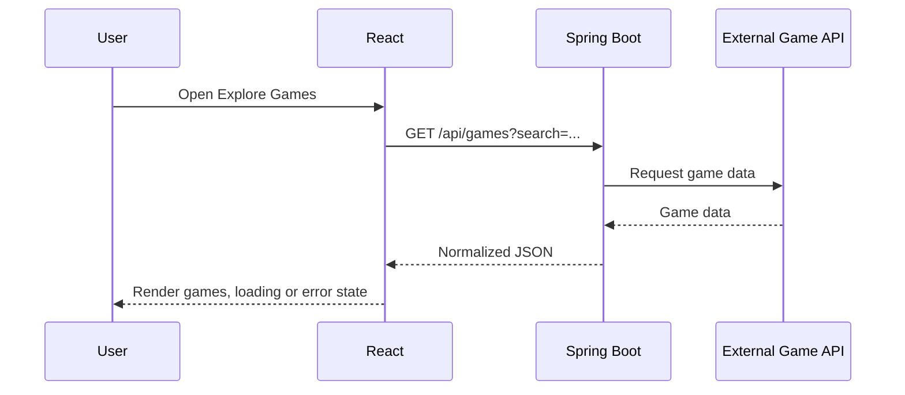
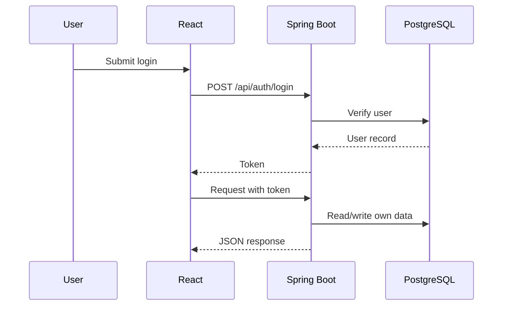

# GameHub Project Plan

This document preserves the original GameHub project plan and the decisions made during planning. It separates what was decided, what is planned, what exists in the repository today, and what is still open. It is meant to be read before continuing development so the project direction is not accidentally changed.

Status labels used throughout:

- Original decision — decided during planning, treated as the foundation.
- Planned — intended to be built, not yet built.
- Current — what the repository actually contains today.
- Completed — verified as working.
- Open — still needs a decision.

---

## 1. Project Overview

GameHub is a social gaming platform. It is intended to combine game discovery with social features, rather than being only a game catalog.

Users should be able to:

- Discover games.
- Maintain a personal game library.
- Share gaming experiences (reviews and posts).
- Interact with other gamers (likes and comments).

Preferred build approach: feature-by-feature full-stack development (Option C), with an MVP-first mindset.

Architecture in one line:

React frontend → Spring Boot REST API → PostgreSQL database, with the Spring Boot backend also calling an external game API when game data is needed.

Current repository status: the project is past scaffolding. On the backend, the PostgreSQL schema is managed by Flyway (`users` and `profiles` tables exist), the RAWG game API is integrated, and registration plus login credential verification are implemented and manually tested. On the frontend, the site layout (responsive Navbar, Footer, layout route), the game discovery UI (search, game grid, game details, screenshot lightbox), and the authentication UI (login and register forms wired to the backend, a React auth context with a `useAuth` hook, and a Navbar that shows the logged-in user) are built. Register and login now issue a JWT (`{ token, user }` response) that the frontend stores in `localStorage`, and Spring Security is configured (stateless chain, global CORS bean, 401 entry point) — and the backend now reads the token: a `JwtAuthenticationFilter` validates the `Authorization` header, loads the user, and fills the `SecurityContext`, so `GET /api/hello` returns 200 with a valid token and 401 without. Protected React routes now guard `/library` and `/profile`, and the frontend attaches the token to profile calls. User profiles are complete: `profiles` table, `Profile` entity/repository, DTOs, service, controller (`GET/PUT /api/profile/me`), and a React profile page. The social/library features are not built yet. Details are in section 14.

---

## 2. Original Project Vision

GameHub is a social gaming platform where users can discover games, keep personal game libraries, share gaming experiences, and interact with other gamers.

The platform is meant to merge discovery and social features. A user should not just browse games; they should be able to log what they play, review games, and talk with a community.

The Spring Boot backend acts as the integration layer:

- It talks to the external game API for game data.
- It owns GameHub's own user and social data in PostgreSQL.
- It serves clean REST endpoints to the React frontend.

### Data ownership: external vs own

| Data | Source | Notes |
| --- | --- | --- |
| Game names, images, descriptions, genres, platforms, release dates, ratings | External game API (RAWG or selected API) | Fetched by Spring Boot and forwarded to React |
| Users, credentials | GameHub database (PostgreSQL) | Owned and managed by GameHub |
| User profiles | GameHub database | Own and manage profile data |
| Personal game library entries and statuses | GameHub database | Games referenced by external id or cached record |
| Reviews | GameHub database | Linked to a user and a game |
| Posts, comments, likes | GameHub database | Social data owned by GameHub |

Game discovery is expected to rely primarily on the external API through Spring Boot, so it may not need its own database table. Relationships such as libraries and reviews do need a stable way to reference a game, which is discussed in sections 8 and 9.

---

## 3. Technology Stack and Architecture

Planned stack (Original decision):

| Layer | Technology |
| --- | --- |
| Frontend | React, Vite, Tailwind CSS |
| Backend | Java 21, Spring Boot |
| Database | PostgreSQL (chosen because it is easier for the author to deploy) |
| Backend communication | REST APIs |
| Game information | RAWG API, or the external game API selected for the project |
| Auth and authorization | Spring Security and JWT (subject to verification against the existing implementation) |

Current versions found in the repository:

| Layer | Version found |
| --- | --- |
| React | 19.2.x |
| Vite | 8.x |
| Tailwind CSS | 4.3.x via @tailwindcss/vite |
| React Router | 7.18.x |
| Spring Boot | 4.1.1 |
| Java | 21 |
| PostgreSQL driver | runtime, managed by Spring Boot parent |
| dotenv-java | 3.2.0 |

Note: the planned stack listed only React, Vite, and Tailwind for the frontend. React Router and lucide-react are also present in the current project. Whether lucide-react is officially adopted is Open (section 15).

### Architecture

Three responsibilities:

- React — presentation, routing, form handling, calling the REST API, showing loading/error/empty states.
- Spring Boot — REST controllers, services, validation, entities/repositories, JPA, integration with the external game API, authentication.
- PostgreSQL — users, profiles, libraries, reviews, posts, comments, likes.

---

## 4. Development Options Considered

Three approaches were considered.

### Option A — Frontend first

Build the user interface and frontend pages first, then implement the backend and connect everything afterward.

### Option B — Backend first

Build the database, backend APIs, authentication, and business logic first, then develop the frontend and connect it to the backend.

### Option C — Feature-by-feature full-stack development

Build one complete feature at a time. For each feature, implement the necessary database structure, Spring Boot backend, and React frontend, then test the complete feature before moving to the next one.

---

## 5. Final Decision: Option C

Original decision and the foundation of this plan: Option C — feature-by-feature full-stack development.

Why this fits the project:

- Incremental progress: each feature produces a working, testable result.
- Layer understanding: building each feature across PostgreSQL, Spring Boot, and React makes the communication between layers explicit.
- Earlier integration problems: connecting frontend to backend per feature surfaces issues before they pile up.
- Always working: the application has working features throughout development instead of one long unfinished phase.

This decision must not be replaced with frontend-first or backend-first development.

---

## 6. MVP Scope

MVP-first means building a manageable first version before expanding into a larger social platform.

### Core feature 1: Game discovery

- Retrieve game information through RAWG or the selected external API.
- Display games on the Explore Games page.
- Support game search and browsing.
- Display detailed information about an individual game.
- Handle API loading, errors, and empty results.

### Core feature 2: User authentication

- User registration.
- User login and logout.
- Secure authentication using the selected authentication architecture.
- Protected pages and authenticated API requests.
- User-specific data associated with the authenticated account.

### Core feature 3: User profiles

- View a user's profile.
- Display relevant gaming information.
- Allow users to manage their own profile.
- Show appropriate public profile information.

### Core feature 4: Personal game library

- Add games to a user's personal library.
- Track statuses such as Playing, Completed, Plan to Play, and Dropped.
- View and manage the library.
- Ensure each user's library belongs to the correct account.

### Core feature 5: Reviews

- Allow users to review games.
- Display reviews on appropriate game pages.
- Associate each review with its author and game.
- Support editing or deleting a user's own review where planned.

### Core feature 6: Community posts and interactions

- Create gaming-related posts.
- Display community posts.
- Allow users to like posts.
- Allow users to comment on posts.
- Associate posts and comments with their authors.

### Essential vs enhancement within MVP features

| Feature | Essential for MVP | Enhancement later |
| --- | --- | --- |
| Game discovery | List, search, detail, loading/error/empty states | Advanced filters, sorting, recommendations |
| Authentication | Register, login, logout, protected routes | Password reset, email verification, remember me |
| Profiles | View profile, edit own profile, public view | Avatars upload, stats, activity timeline |
| Library | Add/remove, statuses, list | Custom lists, playtime, ratings-only entries |
| Reviews | Create, display, author/game link | Edit/delete (planned), rating breakdown, likes on reviews |
| Posts | Create, display, like, comment | Edit/delete, media attachments, reporting, moderation |

Edit and delete for reviews is listed in the plan as "where planned", so it is Planned rather than Essential.

---

## 7. Features Deferred Until Later

These are potential future enhancements, not current implementation requirements. Do not make them prerequisites for completing the first version.

- Real-time chat.
- Advanced friendship and following systems.
- Notifications.
- Tournaments and competitive events.
- AI-powered features.
- A separate mobile application.

---

## 8. Planned Data Model

Conceptual entities discussed for GameHub. Only the entities below were planned; none are assumed to exist in code until verified in section 14.

| Entity | Purpose | Status |
| --- | --- | --- |
| User | Account and credentials | Implemented |
| User profile | Profile data and gaming info | Implemented |
| Game reference or cached game info | Optional local reference to external games | Planned, conditional |
| Personal game library entry | Links a user to a game with a status | Planned |
| Review | A user review of a game | Planned |
| Community post | A user post | Planned |
| Comment | A comment on a post | Planned |
| Like or reaction | A user reaction to content | Planned, if implemented |

### Likely relationships

- A user has a profile.
- A user can maintain many library entries.
- A library entry references a game.
- A user can write multiple reviews.
- A game can have multiple reviews.
- A user can create multiple posts.
- A post can have multiple comments.
- A comment belongs to a post and an author (user).
- Likes are associated with users and the content they like (a post, or possibly other content).

### Game reference question

Reviews and library entries need to refer to a game. Because game data comes from the external API, there are two options:

- Store only the external game id (plus a few cached display fields) on the library/review record and re-fetch details from the external API when needed.
- Store a local game reference or cached row and link library/review records to it.

This is an Open decision (section 15). The plan is to avoid creating unnecessary database tables for game information that can simply be retrieved from the external API.

### Proposed vs confirmed schema

- Proposed schema decisions: all entities and relationships in this section are proposed based on the planning discussion.
- Confirmed schema decisions: the `users` table exists (Flyway `V1__create_users_table.sql`, mapped by `User`) with `id` (generated primary key), `username` (unique, required), `email` (unique, required), `password_hash` (required), `created_at` (defaults to current timestamp). The `profiles` table exists (Flyway `V2__create_profiles_table.sql`, mapped by `Profile`) with `id`, `user_id` (FK → `users.id`, `UNIQUE`, `ON DELETE CASCADE`), `bio`, `avatar_url`, `created_at`; the relationship is one-to-one. Both entities have repositories; profiles are served by `GET/PUT /api/profile/me` (verified in section 14). No other entity exists in code yet.

---

## 9. Feature-by-Feature Implementation Roadmap

Follows Option C: each feature is implemented across the necessary layers before moving on. Dependencies are adjusted only when needed, with the reason given.

Each phase lists: purpose, implementation sequence, dependencies, expected result, acceptance criteria, and completion status.

### Phase 1 — Project foundation

Purpose: establish a working environment where frontend and backend run independently and can talk to each other.

Implementation sequence:

1. Inspect and organize the existing project.
2. Confirm the frontend and backend run independently.
3. Configure the PostgreSQL database.
4. Establish Spring Boot database connectivity.
5. Establish React-to-Spring Boot API communication.
6. Configure environment variables safely.
7. Verify the complete development environment.

Dependencies: none.

Expected result: a running React app, a running Spring Boot app, a reachable PostgreSQL database, and a request from React reaching a Spring Boot endpoint.

Acceptance criteria:

- Frontend dev server starts and serves a page.
- Backend starts and serves an endpoint.
- PostgreSQL connection succeeds.
- React can call a backend endpoint and receive a response.
- Secrets are kept out of version control.

Completion status: Completed.

- Frontend scaffold and routes: Completed (layout + pages built, see section 14).
- Backend scaffold and hello endpoint: Current.
- PostgreSQL configuration: Completed (Neon-hosted PostgreSQL; connection uses environment variables).
- Database connectivity: Completed (Flyway migrations apply against the database; the app starts successfully).
- React-to-Spring Boot call: Completed (the Explore page fetches games from the backend).
- Env handling: Completed (dotenv loads .env; DB keys and the RAWG API key are read from environment variables; .env is untracked).

Note: the backend uses Flyway for schema migrations and `spring.jpa.hibernate.ddl-auto=none`, so the schema is managed deliberately. The RAWG API key is server-side only.

### Phase 2 — Game discovery

First substantial feature to demonstrate the complete full-stack workflow.

Implementation sequence:

1. Identify the game data required by the Explore Games page.
2. Determine what can be obtained from RAWG and what needs to be stored locally.
3. Create any necessary backend integration and configuration.
4. Implement the Spring Boot service and API endpoint for retrieving games.
5. Connect the React Explore Games page to the backend.
6. Implement loading, error, and empty states.
7. Test the complete flow from the external API through Spring Boot to React.

Dependencies: Phase 1 (backend running, configuration in place).

Expected result: Explore Games page shows real games from the external API through Spring Boot, with search and a game detail view.

Acceptance criteria:

- Backend exposes endpoints for listing/searching games and fetching a single game detail.
- External API key is configured and not committed.
- React renders games, loading state, error state, and empty state.
- Searching updates the list.
- Selecting a game shows detail information.

Completion status: Completed (frontend + backend integration verified manually).

- Backend exposes endpoints to list games, search by name, fetch a single game, and fetch screenshots (all via RAWG through Spring Boot).
- The RAWG API key is configured server-side and not committed.
- The React Explore page renders games, a loading state, an error state, and an empty state.
- Searching by name updates the list.
- Selecting a game opens a detail page with genres, developers, publishers, platforms, description, and a screenshot lightbox.

Note: game data is not stored in GameHub's database — it is proxied from RAWG, consistent with the plan. Whether local game records or external API identifiers are needed for library and review relationships is covered in section 8 and remains Open.

### Phase 3 — Authentication

Implementation sequence:

1. Design the user model and database structure.
2. Implement registration and login endpoints.
3. Configure authentication and authorization.
4. Connect React forms to the backend.
5. Implement protected routes and session/token handling.
6. Test successful and unsuccessful authentication.

Dependencies: Phase 1. Can be developed before or after Phase 2; the listed order keeps discovery first to satisfy the goal of demonstrating the full-stack flow early.

Expected result: users can register, log in, log out, and reach protected pages only when authenticated.

Acceptance criteria:

- Registration stores a user securely.
- Login returns a working token/session.
- Protected backend endpoints reject unauthenticated requests.
- React hides or blocks protected routes when unauthenticated.
- Logout clears the session/token.

Completion status: Completed.

- User model + `users` table via Flyway: Completed.
- Registration endpoint `POST /api/auth/register`: Completed and manually tested (validation, BCrypt hashing, duplicate email returns 409, validation errors return 400).
- Login endpoint `POST /api/auth/login`: Completed credential verification and manually tested (correct credentials succeed; wrong password and unknown email both return 401).
- React login page connected: Completed — the form calls `loginUser`, destructures `{ token, user }`, then the auth context `login(user, token)`, then `navigate('/home')`.
- React register page connected: Completed — the form calls `registerUser`, then `login(user, token)` and `navigate('/home')`; duplicate and validation errors are shown.
- Client-side session (React context + `useAuth` hook): Completed — `AuthProvider` holds the current user and persists it to `localStorage` (`user_Data`); the JWT is stored under `token`. The initializer self-heals corrupt stored JSON via `try/catch`. The user object is a UX convenience only; it carries no security.
- Logout: Completed — clears the context and both `localStorage` keys, then navigates home.
- Token issuance: Completed — `AuthController` injects `JwtService` and returns `AuthResponse` (`{ token, user }`) from register and login; verified manually (2026-10-18).
- CORS + 401: Completed — global `CorsConfigurationSource` bean (origin `http://localhost:5173`, `/api/**`) answers the browser preflight; `authenticationEntryPoint` returns 401 JSON instead of Spring's default 403.
- `JwtAuthenticationFilter` + chain registration: Completed — reads `Authorization: Bearer`, parses with `JwtService`, loads the user via `UserService.findById`, sets `SecurityContextHolder`; registered via `addFilterBefore(..., UsernamePasswordAuthenticationFilter.class)`; invalid/absent tokens fail safe to 401. Manually tested (2026-10-18): valid token → 200, no token → 401, garbage token → 401.
- `GET /api/users/me` (`UserController`): Completed — returns the authenticated user's `id`/`userName`/`email` from the SecurityContext principal; verified by curl (2026-10-18). `RegisterResponse.getid()` renamed to `getId()` — Jackson 3 ignored the non-standard name, so `id` was missing from JSON until fixed.
- Frontend session validation on boot: Completed — `getCurrentUser()` in `authService.js` calls `/api/users/me` with the stored token; `AuthProvider` runs it in a `useEffect([])`, refreshes the stored user on success, and logs out only on 401.
- Protected React routes: Completed (2026-10-19) — `PrivateRoute` component (`loading` → placeholder, no `user` → `<Navigate to="/login" replace />`, otherwise `<Outlet/>`); `/library` wrapped in it inside `MainLayout`. `AuthProvider` exposes a `loading` state set to `false` in `.finally()` after boot validation.
- Attaching `Authorization` on future feature requests: pattern established in `getCurrentUser`; will be applied when library/reviews endpoints are built.

Note: Spring Security and JWT now both issue *and* read tokens — the filter authenticates requests server-side, so `/api/hello` is genuinely protected. The remaining gap is on the client: it does not attach the token yet, and no user-specific endpoint (`/api/users/me`) exists. The frontend `token` in `localStorage` is the agreed interim storage (XSS trade-off open, section 15).

### Phase 4 — User profiles

Implementation sequence:

1. Define profile data and relationships.
2. Implement backend endpoints.
3. Build the React profile pages.
4. Connect the frontend to the backend.
5. Test profile ownership and data access.

Dependencies: Phase 3 (a profile belongs to an authenticated user).

Expected result: users can view and edit their own profile and view other users' public profiles.

Acceptance criteria:

- Owner can edit their profile and changes persist.
- Public profile shows only public information.
- Editing is restricted to the owner.

Completion status: Completed (2026-10-19).

- Profile model decision (2026-10-19): separate `profiles` table (Option B) — keeps auth data (`users`) separate from display data (`profiles`); one-to-one via `user_id` FK with `UNIQUE` + `ON DELETE CASCADE`.
- Flyway `V2__create_profiles_table.sql`: Completed — applied; `profiles` table visible in the database.
- `Profile` entity (`entity/Profile.java`): Completed — maps `profiles` table; `@OneToOne` + `@JoinColumn(name = "user_id")`; fields `id`, `user`, `bio`, `avatarUrl`, `createdAt`; getters/setters/constructors.
- `ProfileRepository`: Completed — extends `JpaRepository<Profile, Long>`; `findByUserId(Long)` returns `Optional<Profile>`.
- `ProfileRequest` / `ProfileResponse` DTOs: Completed.
- `ProfileService`: Completed — `getProfileUserById`; `saveProfile` create-or-update with `@Transactional`.
- `ProfileController`: Completed — `GET /api/profile/me` (200 or 404), `PUT /api/profile/me` (upsert); reads the principal from the SecurityContext.
- Frontend profile page (`/profile`, protected): Completed — loads/edits `bio` + `avatarUrl`, live avatar preview, save, error/success banners; `/profile` route in `PrivateRoute`; Profile link in the Navbar.
- CORS fix: the global `CorsConfigurationSource` is now wired explicitly via `.cors(cors -> cors.configurationSource(...))`; preflight returns `Access-Control-Allow-Origin`.
- Verified (2026-10-19): `mvnw.cmd clean compile`, `npm run lint`, `npm run build`; manual `PUT`/`GET /api/profile/me` against the running backend.

### Phase 5 — Personal game library

Implementation sequence:

1. Design the library relationships and status model.
2. Implement the necessary backend endpoints.
3. Build the React library interface.
4. Connect the frontend to PostgreSQL-backed functionality.
5. Test adding, updating, viewing, and removing library entries.

Dependencies: Phase 2 (game reference) and Phase 3 (owner account).

Expected result: each user maintains a library of games with a status.

Acceptance criteria:

- Add a game to the library.
- Set status: Playing, Completed, Plan to Play, Dropped.
- View and update the library.
- Remove an entry.
- Entries are scoped to the authenticated user.

Completion status: Not started.

### Phase 6 — Reviews

Implementation sequence:

1. Define review data and relationships.
2. Implement backend validation and endpoints.
3. Build review creation and display interfaces.
4. Connect reviews to users and games.
5. Test review ownership and persistence.

Dependencies: Phase 2 (game) and Phase 3 (author).

Expected result: users can review games and see reviews on game pages.

Acceptance criteria:

- Create a review tied to an author and game.
- Reviews appear on the relevant game page.
- A user can edit or delete their own review (where planned).
- Reviews cannot be attributed to another user.

Completion status: Not started.

### Phase 7 — Community posts

Implementation sequence:

1. Implement posts, likes, and comments.
2. Establish the required database relationships.
3. Implement Spring Boot endpoints and validation.
4. Build the React community interface.
5. Connect and test each interaction.

Dependencies: Phase 3 (authors). Independent of Phase 2 in data terms but narratively placed after reviews.

Expected result: a community feed where users post, like, and comment.

Acceptance criteria:

- Create and display posts.
- Like and unlike posts.
- Comment on posts.
- Posts and comments show their authors.

Completion status: Not started.

### Phase 8 — Testing and deployment

Implementation sequence:

1. Test each feature individually and in combination.
2. Verify authentication and authorization.
3. Verify database persistence.
4. Handle API failures and invalid input.
5. Configure production environment variables.
6. Deploy the frontend, backend, and PostgreSQL database.
7. Verify the deployed application end to end.

Dependencies: all feature phases.

Expected result: a deployed, working GameHub verified end to end.

Acceptance criteria:

- All MVP features work in the deployed environment.
- Auth and authorization hold under test.
- Data persists across restarts.
- Failures and invalid input are handled gracefully.
- No secrets are exposed.

Completion status: Not started.

---

## 10. API and Data Flow

The backend owns GameHub data and proxies external game data. Rows marked Current exist in code; the rest are Planned.

| Area | Method | Path | Source | Status |
| --- | --- | --- | --- | --- |
| Health/greeting | GET | /api/hello | Spring Boot | Current — protected (401 without token; 200 with valid Bearer token) |
| Game list | GET | /api/games | External API via Spring Boot | Current |
| Game search by name | GET | /api/games-name?name= | External API via Spring Boot | Current |
| Game detail | GET | /api/games/{id} | External API via Spring Boot | Current |
| Game screenshots | GET | /api/games/{id}/screenshots | External API via Spring Boot | Current |
| Register | POST | /api/auth/register | PostgreSQL | Current (returns `{ token, user }`, 201) |
| Login (credential check) | POST | /api/auth/login | PostgreSQL | Current (returns `{ token, user }`) |
| Current user/profile | GET | /api/users/me | PostgreSQL | Current (returns `id`/`userName`/`email`; requires valid token) |
| Current profile | GET | /api/profile/me | PostgreSQL | Current (requires token; 404 if none exists) |
| Update profile | PUT | /api/profile/me | PostgreSQL | Current (requires token; creates or updates) |
| Public profile | GET | /api/users/{id} | PostgreSQL | Planned |
| Library | GET/POST/PUT/DELETE | /api/library | PostgreSQL | Planned |
| Reviews | GET/POST/PUT/DELETE | /api/reviews | PostgreSQL | Planned |
| Posts | GET/POST | /api/posts | PostgreSQL | Planned |
| Comments | GET/POST | /api/posts/{id}/comments | PostgreSQL | Planned |
| Likes | POST/DELETE | /api/posts/{id}/like | PostgreSQL | Planned |

### Discovery flow (external data)

### Auth and social flow (own data)

### Layer roles

- PostgreSQL: schema, constraints, and relationships for features that need persistence.
- Spring Boot: entity, repository, service, validation, and REST controller as appropriate; external API integration for game data.
- React: pages and components, calling the API, handling UI states.
- Integration testing: confirm the complete feature works from the UI through the backend to the required data source.

A feature does not always need a database table. Game discovery primarily uses the external API through Spring Boot. A complete vertical feature is tested before the next feature starts because it proves the layers communicate correctly and keeps the project in a working state.

---

## 11. Testing Strategy

Planned approach:

- Test each feature individually as it is built.
- Test features in combination as dependencies grow.
- Verify authentication and authorization.
- Verify database persistence.
- Handle API failures and invalid input.
- For game discovery, verify the external API → Spring Boot → React flow, including loading, error, and empty states.

Current evidence:

- Backend: registration and login were manually tested (correct credentials, wrong password 401, unknown email 401, duplicate email 409, validation 400). Profile `PUT` (create) and `GET` were manually verified, and the CORS preflight was checked with curl (2026-10-19). Only a context-load test (BackendApplicationTests, contextLoads) exists as automation.
- Frontend: no test setup configured in package.json; features have been verified manually in the browser.
- Frontend CI checks in use: `npm run lint` (ESLint) and `npm run build` (Vite) both pass.

This is Open: a testing tool for the frontend still needs to be chosen, and backend feature tests have not been automated.

---

## 12. Deployment Strategy

Planned approach:

- Deploy frontend, backend, and PostgreSQL.
- Configure production environment variables (not committed).
- Verify the deployed application end to end.

PostgreSQL is preferred because it is easier for the author to deploy. Specific hosting targets are Open (section 15).

Current status: Not started. No deployment configuration exists.

---

## 13. Development Preferences and Rules

These preferences must be preserved:

- Use Option C: feature-by-feature full-stack development.
- Follow an MVP-first approach.
- Prefer PostgreSQL because it is easier to deploy.
- Keep the architecture understandable and maintainable.
- Avoid implementing too many features at once.
- Avoid unnecessary dependencies and premature complexity.
- Use the existing project structure where appropriate.
- Make decisions based on actual requirements, not because a feature is common in other social platforms.
- Explain significant architectural decisions and their trade-offs.
- Keep secrets out of version control (.env is untracked and ignored).

---

## 14. Current Implementation Status

Verified by inspecting the repository and manual testing. The project is past scaffolding.

### Frontend

| Item | Status | Evidence |
| --- | --- | --- |
| Scaffold (React 19, Vite 8, Tailwind v4, React Router 7) | Current | Frontend/package.json, vite.config.js |
| Layout route `MainLayout` (Navbar + `<Outlet/>` + Footer) | Completed | components/layouts/MainLayout.jsx, routes/index.jsx |
| Responsive Navbar (mobile hamburger menu, active-link highlighting) | Completed | components/layouts/Navbar.jsx |
| Responsive Footer | Completed | components/layouts/Footer.jsx |
| HomePage (`/home`) — hero, CTA, feature cards | Completed | pages/HomePage.jsx |
| ExplorePage (`/explore`) — search, grid, loading/error/empty states | Completed | pages/ExplorePage.jsx |
| GameDetailsPage (`/game/:id`) — details + screenshot lightbox | Completed | pages/GameDetailsPage.jsx |
| GameCard component | Completed | components/GameCard.jsx |
| API service layer (list, search, detail, screenshots) | Completed | services/gameService.js |
| Auth service layer (`registerUser`, `loginUser`, `getCurrentUser`) | Completed | services/authService.js (`getCurrentUser` calls `/api/users/me` with the stored token) |
| Profile service layer (`getProfile`, `updateProfile`) | Completed | services/profileService.js — attaches `Authorization`, treats 404 as "no profile yet" |
| Auth context + provider + `useAuth` hook | Completed | contexts/authContext.js, contexts/AuthContext.jsx, hooks/useAuth.js; boot `useEffect` validates the session via `getCurrentUser` (refreshes `user_Data` on 200, logs out on 401 only); exposes `loading` (true until boot validation finishes) |
| Auth state mounted app-wide | Completed | main.jsx wraps `<App/>` in `<AuthProvider>` |
| Navbar auth state (shows user name + Logout) | Completed | components/layouts/Navbar.jsx (reads `user.userName`, calls `logout`) |
| LoginPage (`/login`) — form wired to `POST /api/auth/login` | Completed | pages/LoginPage.jsx (destructures `{ token, user }` → `login(user, token)` → `navigate('/home')`) |
| RegisterPage (`/register`) — form wired to `POST /api/auth/register` | Completed | pages/RegisterPage.jsx (destructures `{ token, user }` → `login(user, token)` → `navigate('/home')`) |
| ProfilePage (`/profile`) — view/edit own profile | Completed | pages/ProfilePage.jsx (loads via `getProfile`, saves via `updateProfile`, live avatar preview, error/success banners) |
| MyLibraryPage / CommunityPage | Placeholder only | pages/MyLibraryPage.jsx, pages/CommunityPage.jsx (empty stubs; `/library` is protected by `PrivateRoute`) |
| Protected route guard (`PrivateRoute`) | Completed | routes/PrivateRoute.jsx — `loading` → placeholder, no `user` → `<Navigate to="/login" replace />`, else `<Outlet/>`; wired to `/library` and `/profile` in routes/index.jsx (2026-10-19) |
| Routing | Completed | `/` redirects to `/home`; `/home`, `/explore`, `/library` (protected), `/profile` (protected), `/community`, `/game/:id`, `/login`, `/register` |
| Frontend calls backend | Completed | fetch calls in gameService.js |
| Lint / build | Passing | `npm run lint`, `npm run build` |

### Backend

| Item | Status | Evidence |
| --- | --- | --- |
| Scaffold (Spring Boot 4.1.1, Java 21) | Current | pom.xml |
| dotenv loading of .env | Current | BackendApplication.java |
| PostgreSQL config (Neon, env vars, ddl-auto=none) | Completed | application.properties, .env |
| Flyway migrations | Completed | V1__create_users_table.sql, V2__create_profiles_table.sql |
| `users` table | Completed | Flyway V1 |
| `profiles` table | Completed | Flyway V2 — `user_id` FK → `users(id)`, `UNIQUE`, `ON DELETE CASCADE` (2026-10-19) |
| `User` entity + `UserRepository` | Completed | entity/, repository/ |
| `Profile` entity + `ProfileRepository` | Completed | entity/Profile.java (`@OneToOne` + `@JoinColumn(name = "user_id")`), repository/ProfileRepository.java (`findByUserId`) (2026-10-19) |
| Registration (`POST /api/auth/register`) | Completed, tested | controllers/AuthController.java, services/UserService.java, dto/RegisterRequest.java |
| Login credential verification (`POST /api/auth/login`) | Completed, tested | controllers/AuthController.java, dto/LoginRequest.java |
| BCrypt password hashing | Completed | config/PasswordConfig.java |
| Validation + exception handling (400/401/409) | Completed | dto annotations, controllers/GlobalExceptionHandler.java, execption/InvalidCredentialsException.java, execption/EmailAlreadyExistsException.java |
| CORS for the Vite dev origin | Completed | `CorsConfigurationSource` bean in `config/SecurityConfig.java` (origin 5173, `/api/**`), wired explicitly with `.cors(cors -> cors.configurationSource(...))`; legacy `@CrossOrigin` remains on some controllers |
| External game API (RAWG) integration | Completed | game endpoints used by the frontend |
| JWT — sign/verify (`JwtService`) + config | Completed | services/JwtService.java, application.properties (`jwt.secret`, `jwt.expiration-ms`) |
| JWT — token issuance (`AuthResponse` `{ token, user }`) | Completed, tested | controllers/AuthController.java, dto/AuthResponse.java (2026-10-18) |
| JWT — request filter / authenticated identity | Completed, tested | `security/JwtAuthenticationFilter.java` — parses `Authorization: Bearer`, loads the user, sets `SecurityContextHolder` (2026-10-18) |
| `GET /api/users/me` (`UserController`) | Completed, tested | `controllers/UserController.java` — reads the principal from the SecurityContext, returns `RegisterResponse` (2026-10-18) |
| Profile DTOs (`ProfileRequest`, `ProfileResponse`) | Completed | `dto/ProfileRequest.java` (input: `bio`, `avatarUrl`), `dto/ProfileResponse.java` (output: `id`, `userId`, `bio`, `avatarUrl`, `createdAt`) |
| `ProfileService` | Completed | `services/ProfileService.java` — `getProfileUserById`, `saveProfile` create-or-update with `@Transactional` |
| `ProfileController` | Completed, tested | `controllers/ProfileController.java` — `GET`/`PUT /api/profile/me`, reads the principal (2026-10-19) |
| Protected endpoints | Completed | `GET /api/hello`, `GET /api/users/me`, and `GET/PUT /api/profile/me` accept a valid token (200) and reject without one (401) |
| Automated feature tests | Not started | only contextLoads |
| `mvnw.cmd clean compile` | Passing | verified by author |

Observed notes:

- The frontend includes React Router and lucide-react, which were not in the originally stated stack. React Router is used; lucide-react is installed but still unused (Open, section 15).
- The backend uses package `com.gamehub.backend` with `controllers`, `services`, `entity`, `repository`, `dto`, `config`, and `exception` subpackages.
- Login/register now return `AuthResponse` (`{ token, user }`); the nested user still serializes as `id`/`userName`/`email` because the inner DTO's getters are unchanged. Renaming `RegisterResponse` to a general `UserResponse` would improve clarity (not urgent).
- `RegisterResponse` getter names determine the JSON keys Jackson emits, but only when they follow the JavaBean convention: `getId()` → `id`, `getUserName()` → `userName` (capital N), `getEmail()` → `email`. The old `getid()` was silently ignored by Jackson 3 — `id` was missing from `/me`, register, and login JSON until it was renamed (2026-10-18). The frontend Navbar therefore reads `user.userName`. The entity uses the conventional `getUsername()`; aligning the DTO getter (or adding `@JsonProperty("username")`) would make the key `username`.
- The exception classes live in a misspelled package folder `execption/` while declaring `package com.gamehub.backend.exception`; `PasswordConfig.java` sits in the root package rather than a `config/` package. Cosmetic, not refactored.
- The .env file was committed to git and then untracked (commit caea6b0). Secrets remain in history; rotating them may be advisable. This is Open.

---

## 15. Open Decisions and Dependencies

Open decisions:

- External game API: RAWG is confirmed and integrated. The API key is stored server-side (env variable) and not committed.
- Auth architecture: Spring Security + JWT implemented and verified — stateless filter chain, `JwtService` (HS256), token issuance and request validation, explicit CORS wiring, 401 entry point, protected routes. Still open: refresh-token strategy (single 24h access token is the current choice).
- Game references: store only external ids with cached display fields, or store a local game record for libraries and reviews. Still open.
- Profile model: decided (2026-10-19) — separate `profiles` table (one-to-one with `users`) and a `Profile` entity. Implemented.
- Reviews: whether edit/delete is in the MVP or right after. Still open.
- Likes/reactions: which content types can be liked. Still open.
- Frontend testing tool: choose one. Still open.
- lucide-react: officially adopted or incidental. Still open (installed but unused).
- Deployment targets for frontend, backend, and PostgreSQL. Still open.
- CORS between the Vite dev server and Spring Boot: resolved (2026-10-19). `.cors(Customizer.withDefaults())` did not pick up the bean; explicit wiring (`.cors(cors -> cors.configurationSource(...))`) fixed preflight for all `/api/**` paths. The legacy `@CrossOrigin` annotations are redundant. Revisit allowed origins when a production frontend URL exists.
- Client-side session approach: the JWT is stored in `localStorage` (`token`) and the user object in `user_Data`. `token` storage is functional but carries an XSS trade-off (vs httpOnly cookies) — still the chosen interim approach now that the filter is implemented.
- Secrets in git history from the earlier .env commit: whether to rotate. Still open.

Dependencies between features:

- Authentication depends on the user model.
- Library and reviews depend on authentication and on a game reference.
- Profiles depend on authentication.
- Community posts depend on authentication.
- Deployment depends on all MVP features.

---

## 16. Long-Term Ideas

Beyond the MVP and separable from it:

- Real-time chat.
- Advanced friendship and following systems.
- Notifications.
- Tournaments and competitive events.
- AI-powered features.
- A separate mobile application.

These are ideas only. They must not block MVP completion.

---

## 17. Immediate Next Steps

1. Phase 4 is complete (2026-10-19): profiles work end to end (backend + React page), protected routes guard `/library` and `/profile`, and `profileService` shows the pattern for attaching `Authorization` — reuse it for library/review calls.
2. Next: Phase 5 (personal game library). First decide the game-reference strategy (external RAWG id + cached display fields vs a local game record) — still Open (section 15).
3. Keep .env untracked and consider rotating any secrets already committed.

---

## 18. Project Decision History

| # | Decision | Reasoning | Status |
| --- | --- | --- | --- |
| 1 | Build GameHub as a social gaming platform, not just a catalog | Combine discovery with social features | Original decision |
| 2 | Use React + Vite + Tailwind on the frontend | Modern, familiar tooling | Original decision |
| 3 | Use Java 21 + Spring Boot on the backend | Requested stack, strong REST/JPA support | Original decision |
| 4 | Use PostgreSQL | Easier for the author to deploy | Original decision |
| 5 | Communicate over REST APIs | Simple, clear frontend/backend boundary | Original decision |
| 6 | Use RAWG or the selected external API for game data; backend is the integration layer | Keep the frontend away from the API key and normalize data | Original decision |
| 7 | Use Spring Security + JWT for auth | Secure, stateless-friendly | Original decision, to verify |
| 8 | Choose Option C (feature-by-feature full-stack) over A and B | Incremental, tests layers early, keeps app working | Original decision |
| 9 | Adopt an MVP-first strategy with six core features | Manageable first version | Original decision |
| 10 | Defer chat, friendships, notifications, tournaments, AI, mobile app | Avoid premature complexity | Original decision |
| 11 | Keep PostgreSQL schema management deliberate (ddl-auto=none) | Avoid uncontrolled schema changes | Reflected in current config |
| 12 | Untrack .env and ignore it | Keep secrets out of version control | Completed |
| 13 | Adopt a learn-by-building workflow with AI assistance | The goal is skill growth, not only working code | Original decision |
| 14 | Treat the RAWG API key and other secrets as server-side only | Never expose secrets in frontend, Git, logs, or docs | Original decision |
| 15 | Use Flyway for database migrations with ddl-auto=none | Manage schema changes deliberately and version them | Implemented |
| 16 | Host PostgreSQL on Neon | Easier for the author to deploy and share | Implemented |
| 17 | Verify login credentials without issuing a token yet | Establish frontend structure first; add persistence later | Implemented (temporary) |
| 18 | Use a React Router layout route (`MainLayout` + `<Outlet/>`) for shared chrome | Single place for Navbar/Footer; supports future layout-less pages | Implemented |
| 19 | Canonical home is `/home`; `/` redirects to it with `replace` | Avoids prefix-matching ambiguity for the root path | Implemented |
| 20 | Split auth state into a context file, a provider component, and a `useAuth` hook | Satisfies `react-refresh/only-export-components`; keeps context, provider, and consumer separated | Implemented |
| 21 | Persist the logged-in user in `localStorage` (`user_Data`) for now | Lets the UI survive a refresh before JWT exists; explicitly temporary and not secure | Implemented (temporary) |
| 22 | Keep confirm-password validation on the frontend only | The backend does not need a second password field; validation belongs where the two values are compared | Implemented |
| 23 | Add `@CrossOrigin` scoped to `http://localhost:5173` on the auth controller | The browser blocks cross-origin calls without it; scoped to the dev origin rather than wide open | Implemented (later superseded by the global CORS bean) |
| 24 | Return `AuthResponse` (`{ token, user }`) from register and login; nest the existing user DTO | One response shape for both auth endpoints; nesting keeps the `userName` key the Navbar reads | Implemented (2026-10-18) |
| 25 | Handle CORS globally with a `CorsConfigurationSource` bean in `SecurityConfig` + a 401 JSON entry point | Security filters run before MVC, so `@CrossOrigin` cannot answer preflights once `anyRequest().authenticated()` exists; Spring's default 403 is wrong for a token API | Implemented (2026-10-18) |
| 26 | Store the JWT in `localStorage` (`token`) alongside `user_Data`, and self-heal corrupt stored JSON with `try/catch` | Simple persistence across refreshes; storage is untrusted input so a bad value must not white-screen the app | Implemented (2026-10-18, XSS trade-off open) |
| 27 | Model profiles as a separate `profiles` table (one-to-one via `user_id`) | Keep auth data (`users`) separate from display data; `UNIQUE` + `ON DELETE CASCADE` | Implemented (2026-10-19) |
| 28 | Wire the CORS bean explicitly with `.cors(cors -> cors.configurationSource(...))` | `Customizer.withDefaults()` silently failed to apply the bean; explicit wiring guarantees the filter uses it | Implemented (2026-10-19) |
| 29 | Keep profile endpoints authenticated and read the user from the SecurityContext | The token already identifies the user; the client should not supply a user id | Implemented (2026-10-19) |

This table is the reference for future sessions. Do not change decision 8 (Option C) or the MVP-first strategy without an explicit new decision.

---

## 19. Development and Learning Rules

GameHub is built to improve software development skills, not only to finish a project. The stack is React, JavaScript, Spring Boot, PostgreSQL, and the RAWG API. Frontend, backend, and database are already running, and a RAWG API key is available.

Learning priorities (in order):

1. JavaScript — the main priority, especially objects, arrays, functions, asynchronous code, promises, modules, and error handling.
2. React — understand components, props, state, hooks, and rendering, and how they connect to JavaScript.
3. Spring Boot — understand controllers, services, repositories, DTOs, dependency injection, and database access.

Rules for AI assistance:

1. Read plan.md and inspect the relevant source files before suggesting changes.
2. Before implementing a feature, explain the concepts needed to understand it.
3. Break work into small, understandable steps instead of generating an entire feature at once.
4. Explain what the code does, why it is needed, and when this approach is appropriate.
5. Pay particular attention to JavaScript fundamentals: objects, arrays, functions, asynchronous code, promises, modules, and error handling.
6. When working with React, explain how JavaScript concepts connect to components, props, state, hooks, and rendering.
7. When working with Spring Boot, explain the responsibilities of controllers, services, repositories, DTOs, dependency injection, and database access as relevant.
8. Encourage the author to attempt manageable parts before revealing a complete solution. Give hints first during learning exercises.
9. Do not overwhelm with unrelated concepts or advanced abstractions unnecessary for the current feature.
10. Do not change working code or refactor unrelated parts of the project.
11. Do not expose the RAWG API key or other secrets in frontend code, Git, logs, or documentation.
12. After each feature, give a short knowledge check and a small independent coding exercise.
13. Help debug by explaining the evidence and reasoning instead of immediately replacing code.
14. Keep plan.md updated with verified progress, important decisions, and concepts learned.

Required workflow for each feature:

| Step | Action |
| --- | --- |
| 1 | Explain the feature and its data flow. |
| 2 | Identify the relevant learning concepts. |
| 3 | Give a small exercise or ask the author to explain their understanding. |
| 4 | Implement the feature incrementally with the author's participation. |
| 5 | Test the feature and explain any errors. |
| 6 | Ask the author to explain how the implementation works. |
| 7 | Give one small task to complete independently. |
| 8 | Record the verified result in plan.md. |

Objective: become capable of designing, implementing, debugging, and explaining a full-stack application independently, not just producing working code.

### Concepts learned log

| Date | Feature / Phase | Concept | Notes |
| --- | --- | --- | --- |
| 2026-10-16 | Layout — Navbar | `Link` vs `NavLink`; `className` as a function receiving `{ isActive }` | Function body vs implicit return; active state builds hysteresis styling. |
| 2026-10-16 | Layout — responsive Navbar | `useState` for menu open/closed; mobile-first Tailwind (`hidden md:flex`, `md:hidden`) | Icon swap and position stability; events + CSS visibility are separate concerns. |
| 2026-10-16 | Layout — Navbar bugs | Flex children are laid out inside their container; tailwind arbitrary color typo `text-lime300` | Panel belonged outside the horizontal flex row; fixed-size button for stable icon. |
| 2026-10-16 | Layout — Footer | Semantic HTML (outer `<footer>`), responsive stack→row | `p-5 py-5` redundancy. |
| 2026-10-16 | Layout — HomePage | Heading hierarchy (one `h1`), one `
` per sentence, grid cards | Hard-wrapped line breaks don't reflow; `rounded-xl` consistency. |
| 2026-10-16 | Layout — MainLayout | React Router layout routes + `<Outlet/>`; flex column pins footer | `flex-1` grows the content area; `replace` on `<Navigate>` avoids a history loop. |
| 2026-10-17 | Auth — service/context/component split | One responsibility per layer: service = talk to the server, context = remember the result, component = display | Keeps fetching out of the context and rendering out of the service. |
| 2026-10-17 | Auth — error handling | Reading the JSON error body; `fieldErrors` (400) vs `message` (401/409); attaching `status` to a thrown `Error` | The two error shapes differ, so the component guards with a ternary. |
| 2026-10-17 | Auth — React context & hooks | `createContext`, `<Provider>`, `useContext`, and a custom `useAuth` hook; `react-refresh/only-export-components` | Splitting files keeps ESLint happy and Fast Refresh working. |
| 2026-10-17 | Auth — state vs parameter bug | `setUser(userData)` vs `JSON.stringify(user)`; state updates are async so `user` is stale on the same render | Use the function parameter for what you store; only read state for the current value. |
| 2026-10-17 | Auth — persistence | Lazy `useState(() => ...)` initializer reading `localStorage`; `localStorage` keys | A hard refresh re-reads storage; only `logout` clears the session. |
| 2026-10-17 | Auth — JSON key naming | Jackson derives keys from getters: `getUserName()` → `userName`, `getUsername()` → `username` | The frontend depends on exact key names; the entity used `getUsername` while the DTO used `getUserName`. |
| 2026-10-18 | JWT — access modifiers & Jackson | Java default access is package-private and stops at the package boundary; Jackson only auto-detects `public` getters | Wrong `public` → compile error from other packages, or silently empty JSON; a `record` gives public constructor/accessors for free. |
| 2026-10-18 | JWT — nested response DTO | Wrapping `RegisterResponse` inside `AuthResponse`: outer getters name the outer keys (`token`, `user`), inner getters name the inner keys | Nesting preserved the `userName` key the Navbar already reads — no frontend rename needed. |
| 2026-10-18 | JWT — CORS preflight | Security filters run before the DispatcherServlet, so `@CrossOrigin` can't answer OPTIONS once `anyRequest().authenticated()` exists; `.cors(withDefaults())` discovers a `CorsConfigurationSource` bean by type | Missing bean → preflight 403 → browser never sends the login POST; the bean is a URL-pattern → rules map (like route matching). |
| 2026-10-18 | JWT — entry point | Spring Security's default entry point answers 403; `authenticationEntryPoint` lambda answers 401 JSON | Functional interface used as a callback — same idea as passing an arrow function in JS. |
| 2026-10-18 | Auth — `JSON.stringify(undefined)` | Returns `undefined` (the value, not a string); `localStorage.setItem` coerces it to the literal `"undefined"`; later `JSON.parse` throws | Corrupt storage is persistent — every boot re-reads it until explicitly removed. |
| 2026-10-18 | Auth — `try/catch` on untrusted storage | Lazy `useState` initializer wrapped in `try/catch`: catch removes the junk and returns `null` (self-healing read) | `throw` unwinds the stack until caught; the catch block must supply the return value; wrong *values* (swapped args) never throw — only exceptions are caught. |
| 2026-10-18 | Auth — positional argument order | `login(token, user)` vs `login(userData, token)`: call-site order must match parameter order; object *destructuring* order is irrelevant | A silent bug — no error, just the wrong data stored under the wrong keys. |
| 2026-10-18 | JWT filter — `@Override` contract | `@Override` makes the compiler verify the method name/signature against the parent; the `doFilterInteral` typo failed the build instead of silently never running | A promise enforced at compile time — cheaper than a runtime mystery. |
| 2026-10-18 | JWT filter — always pass the ball | Every path through a filter must end in `chain.doFilter(...)` or the request dies with an empty response | Only deliberate blocking (writing a own response) may stop the chain; the happy path was the one missing it. |
| 2026-10-18 | JWT filter — typed `catch` | Java requires `catch (Type e)` — no bare catch; `e` holds the exception like JS `catch (error)` | The compiler forces you to name what you handle. |
| 2026-10-18 | JWT filter — `SecurityContextHolder` | Thread-local pocket: the filter writes via `setAuthentication`, Spring's `AuthorizationFilter` reads later; one value per request thread | Per-thread state means concurrent users never share identity. |
| 2026-10-18 | JWT filter — `UsernamePasswordAuthenticationToken` | Triplet (principal, credentials, authorities): who / proof already spent (`null`) / roles (`List.of()`) | The common ticket every Spring authentication method eventually produces. |
| 2026-10-18 | JWT filter — fail-safe catch | Invalid token ≈ no token: catch `JwtException`, set nothing, continue unauthenticated → entry point answers 401 | Filters hand off; they don't write error responses. Verified with a garbage-token curl. |
| 2026-10-18 | JWT filter — layer delegation | `UserService.findById` delegates to `UserRepository.findById` (inherited from `JpaRepository`); the filter talks only to the service | Interfaces inherit methods; layering keeps the filter off raw repositories. |
| 2026-10-18 | Frontend — boot validation | `useEffect` with `[]` runs once on mount; promise chain inside (no `async` on the effect itself); only 401 signs the user out — network errors must not | `localStorage` is untrusted; the server is the source of truth for the session. |
| 2026-10-18 | Frontend — case-sensitive storage keys | `user_data` vs `user_Data` are two different localStorage slots; the wrong casing wrote the fresh user where nobody reads it | Same bug family as argument order and `getid()` — structure right, one naming detail wrong, no error. Trace every occurrence of a key. |
| 2026-10-18 | Jackson — JavaBean naming | `getid()` is not `getId()` — Jackson 3 ignores non-standard getters, so `id` silently vanished from JSON (`/me`, register, login) | Convention over configuration: detection follows a naming rule; breaking it fails silently, not loudly. |
| 2026-10-18 | JSON — key order | JSON objects are unordered key-value maps; serialization order (`email` before `userName`) is an implementation detail | Never depend on key order; display order is the UI's job. |
| 2026-10-19 | Profiles — entity vs DTO | Entity maps the `profiles` table (Hibernate); DTOs carry JSON to/from the frontend (Jackson) | Different layers, different jobs — never expose the entity directly. |
| 2026-10-19 | Profiles — `Optional` create-or-update | `findByUserId(...).map(update).orElseGet(create)` handles "exists" and "missing" in one chain | `.map` only runs when present; `.orElseGet` supplies the fallback; both return the saved `Profile`. |
| 2026-10-19 | CORS vs authorization | `permitAll()` controls access; CORS controls which browser origins may call the API | A CORS failure is not fixed by `permitAll` — they are separate layers. |
| 2026-10-19 | Spring — bean discovery vs explicit wiring | `.cors(Customizer.withDefaults())` relied on discovering the bean and silently skipped it; `.cors(cors -> cors.configurationSource(bean))` is explicit | Explicit is predictable — the same idea as passing a function instead of hoping something is found. |
| 2026-10-19 | React — prop names are the contract | `handleSubmit={...}` is just an unknown prop on `<form>`; only `onSubmit` wires the handler | A wrong prop name fails silently and the native submit reloads the page, wiping state. |
| 2026-10-19 | React — `setState` in effects | React 19 lint rejects synchronous `setState` in an effect body; initialize state from `localStorage` instead and update in promise callbacks | Avoids cascading renders; effects should sync with external systems, not derive initial state. |

